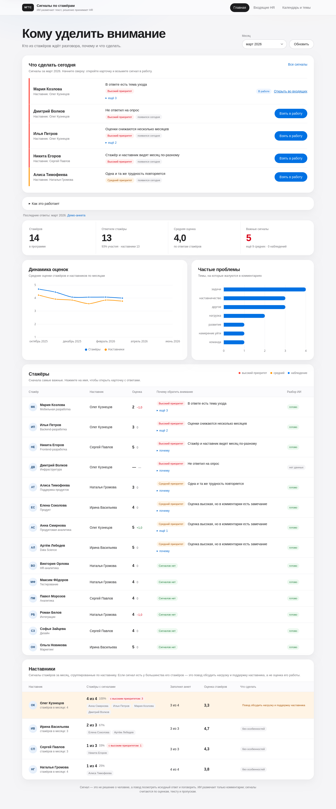

# МГТС · Сигналы по стажёрам

MVP для хакатона «ИИ в бизнес-процессах»: дашборд, который помогает HR увидеть,
кому из стажёров стоит уделить внимание в этом месяце и почему.

ИИ здесь не оценивает человека и не принимает кадровых решений. Он только
размечает текст комментария: настроение, темы, проблемные темы, короткое резюме
и точные цитаты. Флажки риска считает детерминированный движок правил по
оценкам, комментариям, динамике и пропущенным опросам. Рядом с любым выводом ИИ
в интерфейсе всегда виден исходный ответ.



## Что внутри

- **Интерфейс**: спокойный минимализм в духе Apple — крупная типографика,
  системный шрифт, мягкие карточки, сдержанные статусы и мобильная таблица,
  которая превращается в карточки.
- **Общий экран**: KPI программы, динамика оценок стажёров и наставников, частые
  проблемы, список стажёров с цветными флажками.
- **Карточка стажёра**: график оценок по месяцам, сигналы с объяснением и
  ссылками на ответы, история ответов с исходным комментарием, разметкой ИИ и
  цитатами.
- **Входящие HR**: очередь сигналов с фильтрами, назначением ответственного,
  заметками и историей разбора. Для разобранных сигналов виден результат
  следующей анкеты, когда он доступен.
- **Календарь и темы**: сроки опросов, ответы обеих ролей по направлениям,
  черновик напоминания и динамика тем среди стажёров.
- **Приём данных**: CSV-импорт и вебхук Яндекс Форм (плюс универсальный
  canonical-вебхук). Повторный ответ с тем же ID ничего не меняет.
- **LLM**: `mock` для офлайн-демо и тестов, GigaChat, OpenAI-compatible (DeepSeek/OpenAI)
  и YandexGPT. Провайдер переключается переменными окружения.
- **Приватность**: перед отправкой в LLM из текста вырезаются имена, email,
  телефоны и телеграм-контакты. Исходные ответы хранятся без изменений отдельно
  от результатов анализа.
- **Деплой**: Docker Compose (PostgreSQL + API + worker + Caddy), локально можно
  запустить на SQLite без Docker.

## Стек

| Слой | Технологии |
| --- | --- |
| Backend | Python 3.12, FastAPI, SQLAlchemy 2, Pydantic 2 |
| Хранение | PostgreSQL 16 в Docker, SQLite для локального запуска |
| Frontend | HTML + CSS + vanilla JavaScript, Chart.js (локальный файл) |
| LLM | mock, GigaChat, OpenAI-compatible (DeepSeek), YandexGPT |
| Инфраструктура | Docker Compose, Caddy (reverse proxy, HTTPS) |
| Тесты | pytest, SQLite и PostgreSQL в GitHub Actions |

## Быстрый старт без Docker

Нужен Python 3.11+.

```powershell
# из корня репозитория
python -m venv .venv
.\.venv\Scripts\Activate.ps1
pip install -r backend\requirements.txt

cd backend
..\.venv\Scripts\python.exe -m app.cli init --seed
..\.venv\Scripts\python.exe -m uvicorn app.main:app --host 127.0.0.1 --port 8000
```

macOS / Linux:

```bash
python3 -m venv .venv
source .venv/bin/activate
pip install -r backend/requirements.txt
cd backend
python -m app.cli init --seed
python -m uvicorn app.main:app --host 0.0.0.0 --port 8000
```

Откройте:

- дашборд — <http://127.0.0.1:8000/>
- карточка стажёра — <http://127.0.0.1:8000/intern.html?id=3>
- OpenAPI / Swagger — <http://127.0.0.1:8000/docs>

Локальная база — `backend/data/app.db` (SQLite). Демо-данные создаются
командой `init --seed`: 14 стажёров, 6 месяцев, 158 ответов, 30 флажков.
По умолчанию используется провайдер `mock`, поэтому интернет и API-ключи не
нужны.

Полезные команды (из `backend`):

```powershell
..\.venv\Scripts\python.exe -m app.cli seed --reset   # пересоздать демо-данные
..\.venv\Scripts\python.exe -m app.cli analyze        # разобрать ожидающие ответы
..\.venv\Scripts\python.exe -m app.cli recompute      # пересчитать флажки
..\.venv\Scripts\python.exe -m app.cli reset --seed   # очистить и загрузить заново
```

## Docker Compose

```powershell
copy .env.example .env
# при необходимости отредактируйте .env
docker compose up --build -d
```

Откройте <http://localhost>. API и статика проксируются через Caddy.
При старте API создаёт таблицы, а worker разбирает очередь комментариев.
В тестовом окружении можно включить `SEED_ON_STARTUP=true`, чтобы загрузить
набор вымышленных анкет в пустую базу. Для пилота с отдельной базой:

```dotenv
DOMAIN=demo.example.ru
APP_ENV=pilot
DASHBOARD_USER=hr
DASHBOARD_PASSWORD=<надёжный пароль>
DASHBOARD_VIEWER_USER=viewer
DASHBOARD_VIEWER_PASSWORD=<отдельный пароль для просмотра>
WEBHOOK_SECRET=<случайная строка>
POSTGRES_PASSWORD=<пароль базы>
```

Caddy выпустит HTTPS-сертификат автоматически, если DNS домена указывает на
сервер и открыты порты 80/443. Подробности — в `deploy/Caddyfile`.
Учётная запись HR может менять данные, учётная запись просмотра — открывать
дашборд и карточки. Для наблюдателей без доступа к персональным данным показывайте
только агрегаты через отдельный защищённый стенд или используйте вымышленные данные.

## Демо-сценарий

Чтобы отправить вымышленную анкету из браузера, включите
`DEMO_FEEDBACK_ENABLED=true` в локальном `.env` и перезапустите API.
Откройте «Демо-анкета» в шапке дашборда, поставьте оценку и напишите
комментарий. Отправьте оценку 5 от стажёра и 3 от наставника за один месяц в
одном сценарии. В карточке появится `R2`, а ссылка из формы откроет этот
сценарий во «Входящих HR». Возьмите сигнал в работу, затем отметьте его как
разобранный. Для проверки `R5` добавьте отзыв стажёра с повтором той же проблемы
за следующий месяц. «Новый сценарий» создаёт отдельную карточку.
Статистика программы использует анкеты из основной базы опросов.

Полный сценарий на 5 минут — в [docs/demo.md](docs/demo.md). Коротко:

1. Откройте дашборд за **март 2026**: 14 стажёров, 13 ответили, 4 высоких
   сигнала, 9 средних.
2. В списке сверху — Мария Козлова (R3: оценки падают три месяца), Илья Петров
   (R3: устойчивое падение 5 → 3), Никита Егоров (R2: стажёр и наставник видят
   месяц по-разному), Дмитрий Волков (R4: два пропуска подряд).
3. Откройте карточку Марии: график 5 → 2, сигналы с объяснением, ниже — исходные
   комментарии и разметка ИИ с точными цитатами.
4. Проверьте контрольные случаи: у Виктории Орловой, Максима Фёдорова, Павла
   Морозова, Романа Белова, Софьи Зайцевой и Ольги Новиковой сигналов нет.
5. Покажите, что флажок — это не приговор: у каждого есть правило, порог и
   ссылки на ответы, а решение остаётся за HR.

## Правила риска

Флажки считаются в `backend/app/services/rules.py`, пороги — в
`backend/config/rules.json`. ИИ не создаёт флажки: он только даёт
`sentiment` и `problem_topics`, а правила сравнивают их с оценками,
динамикой и пропусками.

| Код | Когда срабатывает | Серьёзность |
| --- | --- | --- |
| **R1** | Оценка ≥ 4, но в комментарии есть негатив/смешанное настроение или проблемная тема | средняя |
| **R2** | Оценки стажёра и наставника за один месяц расходятся на ≥ 2 балла или у них противоположное настроение | высокая при разнице ≥ 2, иначе средняя |
| **R3** | Устойчивое снижение оценок за 3–6 месяцев: наклон ≤ −0,4 балла/месяц и либо два месяца снижения, либо общее падение ≥ 2 баллов | высокая, если последняя оценка ≤ 2 или общее падение ≥ 2 |
| **R4** | Пропущен ожидаемый месячный опрос | высокая при 2+ пропусках подряд, иначе средняя |
| **R5** | Одна и та же проблемная тема повторяется минимум в 2 из 3 последних комментариев стажёра | средняя |
| **R6** | Любая оценка ≤ 2 (опционально, включена в демо) | высокая при ≤ 1,5, иначе средняя |

R1–R4 — ядро из задания, R5–R6 — дополнительные сигналы. Пороги можно менять
без миграций: `program_months`, `r1.high_score`, `r2.gap`, `r3.slope`,
`r3.total_drop`, `r3.latest_low`, `r5.min_repeats`, `r5.window`,
`r6.low_score`, `r6.enabled`.

## Импорт CSV

`POST /api/import/csv` принимает два файла:

- `answers_file` — обязательный, ответы анкет;
- `interns_file` — опциональный справочник стажёров.

Пример `answers.csv` (разделитель `;` или `,`, UTF-8):

```csv
external_answer_id;period;respondent_type;intern_external_id;mentor_external_id;overall;workload;mentorship;comment;submitted_at
int-001-2026-03-intern;2026-03;intern;int-001;men-01;5;4;5;Всё нравится, но задач слишком много;2026-03-28 18:00
int-001-2026-03-mentor;2026-03;mentor;int-001;men-01;5;5;5;Стажёр хорошо справляется;2026-03-28 18:00
```

Пример `interns.csv`:

```csv
external_id;name;direction;mentor_external_id;start_period;status
int-001;Анна Смирнова;Продуктовая аналитика;men-01;2025-10;active
```

Поддерживаются русские заголовки (`стажёр`, `наставник`, `оценка`,
`комментарий`, `период` и т.п.), форматы периода `2026-03`, `03.2026`,
`01.03.2026`. Оценки — от 1 до 5. Ошибки строк возвращаются в `errors`, импорт
не падает целиком. Повторный `external_answer_id` в рамках источника считается
дубликатом.

```bash
curl -X POST http://127.0.0.1:8000/api/import/csv \
  -F "answers_file=@answers.csv" \
  -F "interns_file=@interns.csv"
```

## Вебхук

Универсальный canonical-формат:

```bash
curl -X POST "http://127.0.0.1:8000/api/webhooks/generic" \
  -H "Content-Type: application/json" \
  -H "X-Webhook-Secret: change-me" \
  -d '{
    "source": "generic",
    "external_answer_id": "yf-123",
    "period": "2026-03",
    "respondent_type": "intern",
    "intern_external_id": "int-001",
    "mentor_external_id": "men-01",
    "scores": {"overall": 5, "workload": 4, "mentorship": 5},
    "comment": "Всё нравится, но задач стало слишком много.",
    "submitted_at": "2026-03-28T18:00:00+03:00"
  }'
```

Для Яндекс Форм используйте `/api/webhooks/yandex_forms`. Адаптер принимает
плоский JSON, блок `answers` / `fields` / `data` или список вопросов.
Укажите стабильные идентификаторы полей реальной формы в `YANDEX_FORMS_FIELDS`:

```dotenv
YANDEX_FORMS_FIELDS={"intern-survey":{"overall":"q_score","intern_id":"q_intern","comment":"q_comment","period":"q_month","respondent_type":"intern"},"mentor-survey":{"overall":"q_score","intern_id":"q_intern","mentor_id":"q_mentor","comment":"q_comment","period":"q_month","respondent_type":"mentor"}}
```

Внешние ключи соответствуют `form_id`. Для единой формы с выбором роли
укажите `respondent` с ID поля роли вместо фиксированного `respondent_type`.
При нескольких общих оценках с разными значениями запись попадает в журнал
неразобранных событий. Ответ API — `202 Accepted`, после чего корректные
ответы обрабатываются в фоне.

Повторный запрос возвращает `created: false` и тот же `answer_id`. Если
выгрузка CSV содержит исходный ID ответа формы, повтор из второго канала
сверяется по стажёру, месяцу и роли. Для аналитики по каждому месяцу
используется последний ответ каждой роли, а карточка сохраняет историю.

Секрет: `WEBHOOK_SECRET` в `.env`; передавайте его в заголовке
`X-Webhook-Secret` или параметре `?secret=`. Для Яндекс Форм можно дополнительно
ограничить сеть `2a02:6b8:c00::/40` в Caddy (заготовка в `deploy/Caddyfile`) —
интеграция работает по IPv6.

## LLM

По умолчанию:

```dotenv
LLM_PROVIDER=mock
```

GigaChat:

```dotenv
LLM_PROVIDER=gigachat
LLM_API_KEY=<ключ авторизации из кабинета GigaChat>
GIGACHAT_MODEL=GigaChat
GIGACHAT_SCOPE=GIGACHAT_API_PERS
GIGACHAT_CA_BUNDLE=data/russian_trusted_root_ca_pem.crt
```

Скачайте [корневой сертификат Минцифры](https://developers.sber.ru/docs/ru/gigachat/certificates)
в `backend/data/russian_trusted_root_ca_pem.crt`. Путь в настройках считается от
папки `backend` (в Docker файл попадает в образ при сборке). Для существующего
подключения можно задать `GIGACHAT_BASE_URL=https://gigachat.devices.sberbank.ru/api/v1`.
Новые ответы из вебхука автоматически отправляются на анализ при
`ANALYZE_IN_BACKGROUND=true`.

DeepSeek / любой OpenAI-compatible endpoint:

```dotenv
LLM_PROVIDER=openai
LLM_API_KEY=sk-...
LLM_BASE_URL=https://api.deepseek.com/v1
LLM_MODEL=deepseek-chat
```

YandexGPT:

```dotenv
LLM_PROVIDER=yandex
LLM_API_KEY=<API-ключ>
LLM_FOLDER_ID=<folder-id>
LLM_MODEL=yandexgpt-lite
```

Провайдеры реализуют один интерфейс `BaseProvider` в
`backend/app/services/llm.py`. Схема проверяет обязательные поля и допустимые
коды тем. Для жалобы требуется точная цитата из комментария. Результаты
сохраняются вместе с версией промпта и именем модели. Набор из 40 вымышленных
анкет и команды для оценки описаны в [docs/llm-quality.md](docs/llm-quality.md).

Фоновый worker подбирает прерванные задачи и повторяет временные ошибки с
паузой. Если попытки исчерпаны, в карточке HR видит короткое
сообщения и кнопку «Повторить анализ». Исходный комментарий и оценки
сохраняются отдельно.

## Приватность и ограничения ИИ

- Имена из справочника стажёров и наставников, email, телефоны и telegram-
  контакты заменяются на `[ИМЯ]`, `[EMAIL]`, `[ТЕЛЕФОН]`, `[КОНТАКТ]` до
  отправки в модель (`backend/app/services/anonymize.py`).
- Текст комментария передаётся как данные, а не инструкции; промпт явно
  запрещает выполнять команды из текста. Это снижает риск prompt injection, но
  не устраняет его полностью — для продакшена нужен отдельный review.
- ИИ не ставит флажки, не выбирает серьёзность и не рекомендует увольнение.
  Флажки считает код правил, поэтому результат воспроизводим.
- HR всегда видит исходный комментарий рядом с резюме и цитатами ИИ.
- Исходные ответы не перезаписываются результатами анализа: `answers.comment`
  и `ai_analysis.*` — разные таблицы/поля, анализ можно пересчитать при смене
  модели или промпта.

## API

| Метод | Путь | Назначение |
| --- | --- | --- |
| GET | `/api/health` | Проверка API и БД |
| GET | `/api/periods` | Доступные месяцы |
| GET | `/api/dashboard/summary?period=2026-03` | KPI, динамика, темы, список стажёров |
| GET | `/api/dashboard/calendar?period=2026-03` | Сроки и ответы по ролям и направлениям |
| GET | `/api/dashboard/topics?period=2026-03&months=6` | Число стажёров, отметивших темы, по месяцам и направлениям |
| GET | `/api/signals` | Входящие HR и история разбора сигналов |
| POST | `/api/signals/{id}/actions` | Взятие сигнала в работу или завершение разбора |
| GET | `/api/interns/{id}` | Карточка: график, ответы, анализ, флажки |
| GET | `/api/analysis/queue` | Состояние очереди обработки |
| POST | `/api/import/csv` | Импорт CSV (multipart) |
| POST | `/api/webhooks/{source}` | Приём ответа, 202 + фоновая обработка |
| POST | `/api/interns/{id}/reanalyze` | Пересчитать анализ и флажки стажёра |

Интерактивная документация — `/docs`, схема — `/openapi.json`. Если задан
`DASHBOARD_PASSWORD`, дашборд и API закрыты Basic Auth; вебхук защищается
отдельным секретом.

## Тесты

```powershell
cd backend
..\.venv\Scripts\python.exe -m pytest
```

Покрыты: анонимизация, mock-провайдер и проверка цитат, правила R1–R5,
идемпотентность вебхука, CSV-импорт, карточка стажёра, сквозной seed.
Текущий результат: `19 passed`.

## Структура

```text
mgts-intern-risk/
├── backend/
│   ├── app/
│   │   ├── adapters/          # CSV и Яндекс Формы
│   │   ├── api/               # health, webhooks, imports, dashboard, interns
│   │   ├── services/          # ingest, anonymize, llm, analysis, rules
│   │   ├── config.py          # настройки из .env
│   │   ├── models.py          # SQLAlchemy-модели
│   │   ├── schemas.py         # Pydantic-схемы
│   │   ├── seed_data.py       # демо-данные
│   │   ├── cli.py             # init/seed/analyze/recompute/reset
│   │   ├── worker.py          # фоновый разбор очереди
│   │   └── main.py            # FastAPI + статика
│   ├── config/rules.json      # пороги правил
│   ├── data/seed/             # демо-CSV
│   ├── tests/
│   ├── Dockerfile
│   └── requirements.txt
├── frontend/                  # index.html, intern.html, css, js, Chart.js
├── deploy/Caddyfile
├── docs/                      # архитектура и демо-сценарий
├── docker-compose.yml
├── .env.example
└── README.md
```

## Ограничения и что дальше

- Пороги правил — стартовая гипотеза; их нужно согласовать с организаторами и
  проверить на реальных анкетах. В демо специально есть контрольные случаи без
  сигналов.
- Для широкого развёртывания можно подключить корпоративный вход. В пилоте
  используются учётные записи HR и просмотра, действия над сигналами пишутся в историю.
- Адаптер Яндекс Форм — best-effort; при несовпадении payload нужен маппинг по
  реальной форме.
- Нет уведомлений (email/Telegram) и экспорта — следующий шаг после пилота.
- SQLite — только для локального запуска; в Docker используется PostgreSQL.

## Документация

- [docs/architecture.md](docs/architecture.md) — архитектура, поток данных,
  схема БД, безопасность и компромиссы.
- [docs/demo.md](docs/demo.md) — сценарий демонстрации и разбор кейсов.
