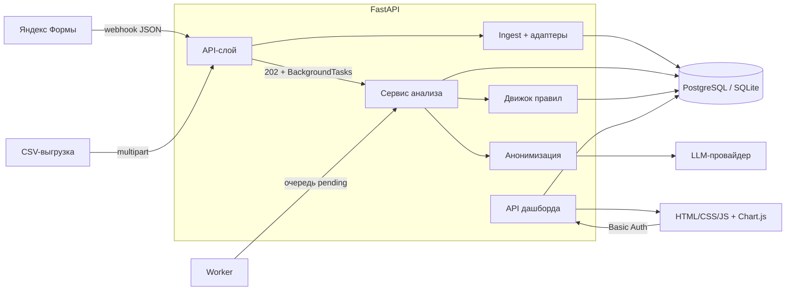
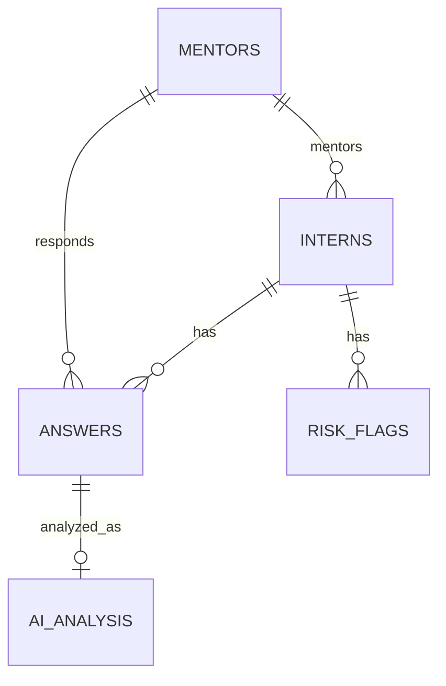

# Архитектура

## 1. Что решаем

Раз в месяц стажёр и наставник заполняют короткую анкету: общая оценка 1–5,
оценки по нагрузке и наставничеству, свободный комментарий. HR нужно быстро
понять, кому уделить внимание, но:

- по одной оценке это не видно: человек может поставить «5» и написать жалобу;
- настроение комментария само по себе ненадёжно, особенно на коротких вежливых
  ответах;
- вывод модели нельзя показывать без исходного текста: HR должен проверить
  цитату и контекст;
- персональные данные сотрудников нельзя бесконтрольно отправлять во внешнюю
  LLM.

Поэтому система разделена на два независимых слоя:

1. **LLM-разметка текста** — только классификация комментария.
2. **Детерминированный движок правил** — флажки, серьёзность и объяснения.

Решение о человеке (поговорить, продлить, завершить стажировку) не
автоматизируется и остаётся за HR.

## 2. Компоненты



### Backend

- `backend/app/main.py` — приложение FastAPI, lifespan (создание таблиц,
  опциональный seed), монтирование статики.
- `backend/app/api/` — HTTP-роутеры: health, webhooks, imports, dashboard,
  interns.
- `backend/app/adapters/` — приведение внешних форматов к `CanonicalAnswer`.
- `backend/app/services/ingest.py` — идемпотентный upsert ответов, создание
  стажёров и наставников.
- `backend/app/services/anonymize.py` — вырезание PII.
- `backend/app/services/llm.py` — провайдеры и валидация ответа модели.
- `backend/app/services/analysis.py` — очередь, вызов LLM, сохранение
  `AIAnalysis`, обработка ошибок.
- `backend/app/services/rules.py` — чистые правила R1–R6 и пересчёт флажков.
- `backend/app/worker.py` — отдельный процесс, который разбирает `pending`.

### Frontend

Два статических экрана без сборки и фреймворков:

- `frontend/index.html` + `js/dashboard.js` — общий экран;
- `frontend/intern.html` + `js/intern.js` — карточка стажёра;
- `js/api.js` — fetch, форматирование, экранирование HTML;
- `vendor/chart.umd.min.js` — Chart.js локально, чтобы демо не зависело от CDN.

Статика отдаётся FastAPI при локальном запуске и Caddy в Docker.

## 3. Поток данных

### Вебхук

1. `POST /api/webhooks/{source}` проверяет `WEBHOOK_SECRET` (если задан).
2. `parse_payload` выбирает адаптер:
   - `yandex_forms` — best-effort разбор payload Яндекс Форм;
   - остальные source — canonical JSON.
3. `upsert_answer` ищет пару `(source, external_answer_id)`. Если ответ уже
   есть, возвращает его и `created=false`; повтор ничего не меняет.
4. API отвечает `202 Accepted` сразу.
5. Если `ANALYZE_IN_BACKGROUND=true`, `BackgroundTasks` запускает
   `analyze_answer_by_id`; в Docker параллельно работает worker, который
   забирает `pending` из БД. Оба пути безопасны: `_claim_answer` атомарно
   переводит строку из `pending` в `processing`, поэтому один ответ не
   обработается дважды.
6. После успешного анализа `recompute_flags` пересчитывает флажки.

Неразобранный payload не теряется: он пишется в `ingest_events` со статусом
`parse_error`, API отвечает `stored_unparsed`. Это позволяет добавить маппинг и
переиграть событие вручную.

### CSV

`POST /api/import/csv` принимает `answers_file` и опциональный `interns_file`.
Строки разбираются независимо: ошибка одной строки попадает в `errors`, остальные
импортируются. Ответы дедуплицируются по тому же ключу, что и вебхуки. После
импорта API возвращает количество новых, дубликатов и ожидающих анализа.

### Анализ комментария

1. Берутся имена стажёров и наставников из БД.
2. `redact_pii` заменяет имена, email, телефоны, telegram-контакты.
3. Провайдер получает системный промпт (только разметка, без рекомендаций) и
   текст в маркерах `<<<COMMENT ... COMMENT>>>`.
4. Модель возвращает JSON: `sentiment`, `topics`, `problem_topics`, `summary`,
   `evidence`, `confidence`.
5. `_validate_result` выбрасывает цитаты, которых нет в исходном комментарии,
   и снижает уверенность, если негатив остался без цитат.
6. Результат пишется в отдельную таблицу `ai_analysis`; исходный
   `answers.comment` не меняется.

Если провайдер упал, ставится `analysis_status=failed` и текст ошибки. Ответ
не блокирует дашборд: HR видит исходные данные и статус «ошибка анализа».

### Правила

`evaluate_intern(intern, answers, as_of, config)` — чистая функция без БД,
поэтому её легко тестировать. `recompute_flags(db)` загружает все ответы,
считает флажки для каждого стажёра и полностью пересоздаёт `risk_flags`.
Пересчёт идемпотентен: ручное изменение порогов не требует миграций.

Флажок содержит:

- `rule_code` — R1–R6;
- `severity` — high / medium / low;
- `title` и `explanation` — человекочитаемое объяснение с цифрами и цитатой;
- `evidence_answer_ids` — ссылки на конкретные ответы;
- `period` — месяц, к которому относится сигнал.

## 4. Схема данных



| Таблица | Назначение |
| --- | --- |
| `mentors` | Наставники: внешний ID, имя |
| `interns` | Стажёры: внешний ID, имя, направление, наставник, старт, статус |
| `answers` | Ответ анкеты: период, роль, оценки, комментарий, сырой payload, статус анализа |
| `ai_analysis` | Разметка ИИ: sentiment, topics, problem_topics, summary, evidence, модель, версия промпта, сырой ответ |
| `risk_flags` | Флажки: правило, серьёзность, объяснение, ссылки на ответы, статус |
| `ingest_events` | Журнал входящих вебхуков, включая неразобранные |
| `sync_runs` | Зарезервировано под будущие импорты/синхронизации |

Ключевые ограничения:

- `UNIQUE(source, external_answer_id)` — идемпотентность;
- `UNIQUE(intern_id, period, rule_code)` — один флажок правила на месяц;
- `ai_analysis.answer_id` уникален и связан каскадным удалением.

## 5. Правила и пороги

Пороги лежат в `backend/config/rules.json`, значения по умолчанию — в
`DEFAULT_RULES` (`services/rules.py`). Файл перечитывается при каждом
пересчёте, поэтому демо можно менять без перезапуска.

| Правило | Логика | Основные пороги |
| --- | --- | --- |
| R1 | Высокая оценка + негативный/смешанный текст или проблемная тема | `high_score=4` |
| R2 | Расхождение оценок стажёра и наставника или противоположное настроение | `gap=2` |
| R3 | Устойчивый тренд вниз по ряду оценок одного респондента | `slope=-0.4`, `total_drop=2`, `latest_low=2` |
| R4 | Нет ожидаемого ответа стажёра за месяц | `program_months=6`; high при 2+ подряд |
| R5 | Повтор проблемной темы в последних комментариях стажёра | `min_repeats=2`, `window=3` |
| R6 | Низкая оценка месяца (опционально) | `low_score=2`, high при ≤1.5 |

R3 считает наклон линейной регрессии по последним до 6 ответам и требует
реального снижения: либо два месяца с падением, либо общее падение на 2 балла.
Один случайный провал не считается трендом.

R4 использует `start_period` стажёра и `program_months`; ожидаемые месяцы
ограничены `as_of` (последний месяц с данными). Пропуск одного месяца —
medium, двух подряд — high.

## 6. Безопасность и приватность

- **Анонимизация до LLM**: имена из справочника, email, телефоны, telegram.
  Это не полная гарантия (имя может быть написано с ошибкой), поэтому в
  продакшене нужен дополнительный контроль и договор с поставщиком модели.
- **Prompt injection**: комментарий передаётся как данные, промпт запрещает
  выполнять инструкции из текста. Валидация цитат не даёт модели выдумывать
  доказательства.
- **Разделение хранения**: исходный ответ и результат ИИ — разные таблицы;
  анализ можно удалить/пересчитать, не теряя оригинал.
- **Basic Auth** для дашборда и API, если задан `DASHBOARD_PASSWORD`.
- **Webhook secret** отдельно от Basic Auth, чтобы формы могли отправлять
  ответы без пароля HR.
- **Caddy** автоматически выпускает HTTPS для домена; в Docker наружу открыты
  только 80/443.
- **Ограничение сети Яндекс Форм** — заготовка в `deploy/Caddyfile`
  (`2a02:6b8:c00::/40`), интеграция работает по IPv6.

## 7. Развёртывание

```text
Интернет
   │ 80/443
   ▼
 Caddy ── /api/*, /docs ──► FastAPI (api)
   │                         │
   └── статика frontend      ├── PostgreSQL
                             └── worker (очередь analysis)
```

- `docker-compose.yml` поднимает `db`, `api`, `worker`, `caddy`.
- API при старте создаёт таблицы и, если `SEED_ON_STARTUP=true`, загружает
  демо-данные. Worker обрабатывает очередь.
- `SEED_ANALYZE=true` заставляет API разобрать демо-комментарии при старте; по
  умолчанию в Docker это делает worker.
- Для локальной разработки SQLite и `uvicorn --reload` достаточны.

## 8. Компромиссы

| Решение | Почему | Цена |
| --- | --- | --- |
| Ванильный JS вместо React | Два экрана, нет сборки, меньше зависимостей | Нет компонентного переиспользования |
| Правила вместо «ИИ решает» | Воспроизводимость, объяснимость, требования задания | Пороги нужно калибровать |
| SQLite локально | Запуск одной командой без Docker | Не для конкурентной нагрузки |
| BackgroundTasks + worker | Быстрый ответ вебхуку и устойчивость к рестартам | Дублирование путей, защищено claim-статусом |
| Mock-провайдер | Офлайн-демо, тесты, отсутствие расходов | Keyword-эвристика, не замена LLM |
| Полный пересчёт флажков | Простота и идемпотентность | На больших объёмах понадобится инкрементальный расчёт |

## 9. Точки расширения

- **Новый источник** — реализовать парсер в `adapters/`, привести к
  `CanonicalAnswer`, добавить в `parse_payload`.
- **Новая модель** — класс-наследник `BaseProvider` в `services/llm.py` и
  ветка в `get_provider()`.
- **Новое правило** — блок в `evaluate_intern`, пороги в `rules.json`, тест в
  `tests/test_rules.py`.
- **Уведомления** — после `recompute_flags` отбирать high-флажки и отправлять
  в корпоративный канал; сейчас сознательно не входит в MVP.
- **SSO/роли** — заменить Basic Auth на корпоративный OIDC, добавить журнал
  просмотров карточек.
