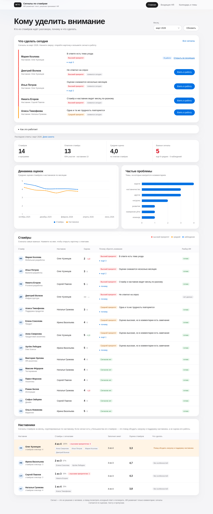
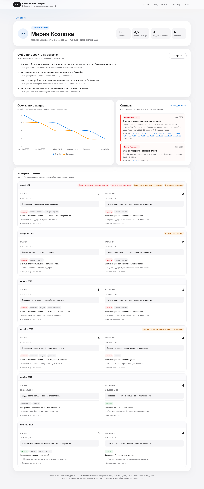

# Демонстрация

Сценарий рассчитан на 5–7 минут. Все цифры ниже соответствуют демо-данным из
`backend/data/seed` и провайдеру `mock`.

## Что показать

1. **Общий экран** — <http://127.0.0.1:8000/>.
2. **Карточка стажёра** — например, Мария Козлова:
   <http://127.0.0.1:8000/intern.html?id=3>.
3. **API** — <http://127.0.0.1:8000/docs>.
4. Опционально — отправка вебхука и повторная идемпотентная отправка.



## 1. Общий экран (1–2 минуты)

Откройте дашборд. По умолчанию выбран **март 2026**.

Что сказать:

- В программе **14 стажёров**, ответили **13** — 93% участия. Один человек не
  ответил, и это уже сигнал.
- Средняя оценка стажёров — **4,0**, но средняя не показывает проблему: у
  троих из четырёх стажёров с высокими сигналами оценки хорошие, а текст или динамика
  говорят другое.
- **5 высоких** сигналов и **9 средних**. Список отсортирован: сначала высокие,
  внутри — по средней оценке.
- Слева график динамики: средние по программе стабильны, поэтому по одному
  графику проблему не увидеть. Справа — частые проблемные темы: задачи,
  наставничество, нагрузка.
- В таблице у каждого стажёра видно правило (`R3`, `R5`, …), серьёзность и
  ссылку на карточку. Это не «рейтинг людей», а очередь на проверку.

Обратите внимание на порядок:

| Стажёр | Оценка | Сигналы марта | Почему сверху |
| --- | --- | --- | --- |
| Мария Козлова | 2 | R3 высокий, R7 высокий, R5, R6 | Падение 5 → 2, «думаю о выходе», повтор проблемы, низкая оценка |
| Илья Петров | 3 | R3 высокий, R5, R6 | Устойчивое падение 5 → 3, R2 в прошлых месяцах |
| Никита Егоров | 5 | R2 высокий | Стажёр ставит 5, наставник — 3 |
| Дмитрий Волков | — | R4 высокий | Два пропуска подряд |
| Алиса Тимофеева | 3 | R5 средний | Нагрузка повторяется |
| Елена Соколова | 4 | R1 средний | «Всё хорошо, но не хватает обратной связи» |
| Анна Смирнова | 5 | R1, R5 | Оценка 5, но жалоба на нагрузку |
| Артём Лебедев | 5 | R1 | Сарказм: «бесконечные правки» |

Ниже — контрольные случаи без сигналов: Ольга Новикова, Виктория Орлова,
Максим Фёдоров, Павел Морозов, Роман Белов, Софья Зайцева. Это важно: система
не обязана находить риск у всех.

## 2. Карточка Марии Козловой (2 минуты)

Нажмите на Марию.



Что показать:

- **График 5 → 2**: оценки стажёра и наставника падают синхронно. Это не
  случайный провал одного месяца.
- **R3 высокий**: «Оценки стажёра снижаются с октября 2025 (5) до марта 2026
  (2); наклон −0,54 балла в месяц». Ниже — то же для наставника: 4 → 2,
  наклон −0,46. В объяснении есть даты, цифры и ссылки на ответы.
- **R5 средний**: тема «наставничество» повторяется в 3 из 3 последних
  комментариев.
- **R6 средний**: оценка 2 за март.
- **R7 высокий**: «Стажёр пишет о намерении уйти за март 2026: «Не хватает
  поддержки, думаю о выходе.»». ИИ поставил тему «намерение уйти» (`leave`),
  а правило подняло высокий сигнал — это главный сигнал удержания.
- В списке сигналов есть прокрутка: в карточке 6 флажков, включая R1 за декабрь
  и R6 за февраль.
- **История ответов**: за каждый месяц рядом стоят исходный комментарий
  стажёра, исходный комментарий наставника, разметка ИИ (настроение, темы,
  резюме, точные цитаты) и ссылка «Исходные данные ответа».
- Подставьте цитату из ИИ к тексту комментария — она совпадает дословно. Это
  специальная проверка: модель не может показывать выдуманные цитаты.

Ключевая мысль: ИИ только разметил текст, а флажок R3 посчитан правилом по
оценкам. Если убрать ИИ, R3 всё равно сработает; если убрать оценки, R1/R2/R3
перестанут быть доказуемыми.

## 3. Расхождение и пропуск (1–2 минуты)

Вернитесь назад и откройте **Никиту Егорова**.

- Стажёр ставит **5**, наставник — **3** каждый месяц. R2 высокий: «Стажёр
  доволен, а наставник видит проблемы».
- На графике две линии расходятся. В комментариях: стажёр доволен задачами,
  наставник пишет «не хватает самостоятельности».
- Это не значит, что кто-то врёт. Это значит, что взгляды расходятся и стоит
  поговорить обоими.

Откройте **Дмитрия Волкова**.

- За февраль и март нет ответов; R4 сначала средний, затем высокий — два
  пропуска подряд.
- Нет комментария и нет анализа ИИ — интерфейс честно показывает «нет данных».
  Молчание — тоже сигнал, но не повод для вывода о человеке.

Откройте любого контрольного стажёра, например **Ольгу Новикову**: сигналов
нет, зелёное сообщение объясняет, что данные не расходятся. Это защита от
«система везде видит риск».

## 4. API и идемпотентность (1 минута, опционально)

Откройте `/docs` и покажите:

- `POST /api/webhooks/{source}` — приём ответа, `202 Accepted`;
- `POST /api/import/csv` — резервный путь через выгрузку;
- `GET /api/dashboard/summary?period=2026-03` — те же данные, что на экране;
- `POST /api/interns/{id}/reanalyze` — пересчёт при смене модели/промпта.

Пример повторной отправки:

```bash
curl -X POST "http://127.0.0.1:8000/api/webhooks/generic" \
  -H "Content-Type: application/json" \
  -d '{"external_answer_id":"demo-1","period":"2026-03","respondent_type":"intern","intern_external_id":"int-001","mentor_external_id":"men-01","scores":{"overall":5},"comment":"Всё хорошо"}'
```

Первый ответ — `created: true`, второй с тем же `external_answer_id` —
`created: false` и тот же `answer_id`. Это требование Яндекс Форм: они
повторяют запрос при 5XX/404.

## 5. Вопросы жюри

**Почему ИИ не решает сам?**
Потому что цена ошибки — репутация и судьба человека. Модель ошибается на
коротких вежливых ответах и может галлюцинировать. Мы оставили ИИ только
разметку текста, а правила и пороги сделали детерминированными и
объяснимыми. HR видит исходный ответ и принимает решение сам.

**Как вы проверяли правила?**
В демо 14 стажёров и заложенные кейсы: высокая оценка + жалоба, расхождение,
устойчивое падение, пропуск, повтор темы, низкая оценка, намерение уйти и контрольные случаи
без сигналов. 19 автотестов покрывают правила, анонимизацию, идемпотентность,
CSV и API. Пороги вынесены в `rules.json` и будут калиброваться с
организаторами.

**Что будет, если LLM недоступна?**
Ответ сохранится, анализ получит статус `failed`, дашборд покажет ошибку, а
исходные данные останутся. Можно переанализировать позже или сменить
провайдера. Приём ответов не блокируется.

**Как обеспечиваете приватность?**
До отправки в модель вырезаем имена, email, телефоны и telegram. Исходный текст
и результат анализа хранятся раздельно. Провайдер переключается: для данных
сотрудников можно выбрать YandexGPT или корпоративный шлюз. Это не абсолютная
гарантия — остаточный риск и договор с поставщиком нужно обсуждать отдельно.

**Почему не React?**
Два экрана, нет сборки, меньше зависимостей и кода. Жюри может открыть
`frontend/js/dashboard.js` и прочитать его без инструментов. Когда появятся
сложные формы и роли, фреймворк можно добавить.

**Что дальше?**
SSO и роли, журнал аудита, уведомления по высоким сигналам, GigaChat-адаптер,
инкрементальный пересчёт флажков, калибровка порогов на реальных анкетах.

## Если что-то пошло не так

| Симптом | Что сделать |
| --- | --- |
| «Нет данных» на дашборде | `cd backend` и `..\.venv\Scripts\python.exe -m app.cli init --seed` |
| «Анализ идёт» не исчезает | запустить worker `python -m app.worker` или `python -m app.cli analyze` |
| `401` на дашборде | задан `DASHBOARD_PASSWORD`; введите логин/пароль или очистите переменную |
| Порт 8000 занят | `uvicorn ... --port 8001` и открыть новый порт |
| Docker: нет демо-данных | `docker compose exec api python -m app.cli seed --reset` |
| Docker: `/docs` отдаёт дашборд | проверить, что Caddy проксирует `/docs`, и перезапустить `caddy` |
| Нужно начать заново | `python -m app.cli reset --seed` (локально) |
| Хочу другой месяц | селектор «Месяц» на дашборде или `?period=2026-02` |
